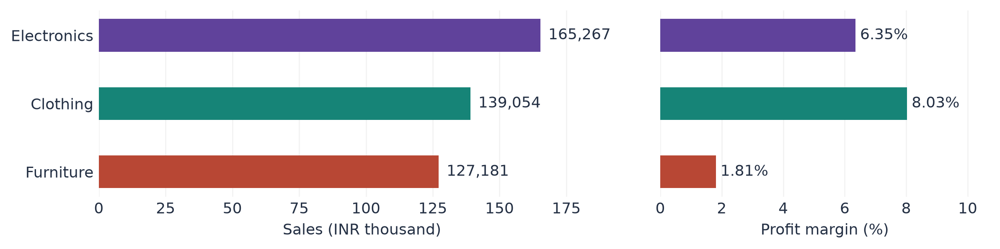

# Jar Growth Case Study

**Retail analysis. Product experience. A measurable growth experiment.**  
By **Anusha Kumari** · Python · pandas · Matplotlib

An internship case study combining transaction analysis, a public-evidence review of Jar, and a proposed 90-day growth pilot.

**[Read the editable report](output/Anusha_Kumari_Jar_Growth_Intern_Assignment.docx)** · **[Explore the results](analysis/)** · **[View the code](scripts/)**



## What the data reveals

**500 orders · 1,500 order lines · 36 targets · April 2018–March 2019**

| Finding | Implication |
| --- | --- |
| Clothing has the highest margin: **8.03%** | Investigate what supports its stronger profitability. |
| Furniture margin is **1.81%**; Tables lose **4,011** | Prioritise the weakest subcategory before pushing volume. |
| Furniture reaches **95.70%** of its annual target | Review monthly targets alongside actual performance. |

The report also covers regional performance, **five UX strengths and five improvements**, and three expansion opportunities with a recommended pilot.

## Repository map

| Location | Contents |
| --- | --- |
| `output/` | Final editable Word report |
| `report_source.md` | Report source, with generated tables and chart placeholders |
| `scripts/` | PDF extraction, validation, analysis, charts and report generation |
| `data/` | Extracted tables and joined order lines, with source references |
| `analysis/` | Results, validation audit and source citations |
| `assets/` | Five charts in PNG and editable SVG, plus the cited Jar screenshot |
| Root `*.pdf` files | Three supplied datasets used to reproduce the analysis |

## Reproduce

Use **Python 3.12**. From this folder, run in Windows PowerShell:

```powershell
python -m venv .venv
.\.venv\Scripts\python.exe -m pip install -r requirements.txt
.\.venv\Scripts\python.exe scripts/analyze.py
.\.venv\Scripts\python.exe scripts/core_analysis.py
.\.venv\Scripts\python.exe scripts/charts.py
.\.venv\Scripts\python.exe scripts/build_report.py
```

This regenerates the data, results, charts and Word report. Save a copy of any manual report edits before rebuilding. For optional layout checks on Windows with Microsoft Word installed, run `./scripts/render_word.ps1`, then `.\.venv\Scripts\python.exe scripts/verify_report.py`.

## Methods and scope

- Dates use day–month–year. A validated many-to-one join preserves line counts, sales and profit; totals reconcile across category, month and geography.
- Profit per order uses **distinct orders**; margin is **total profit ÷ total sales**. Category order counts overlap.
- Three conflicting state/city labels are preserved and examined through a separate sensitivity analysis.
- The retail dataset is supplied assignment data, **not Jar's business metrics**. INR is a presentation assumption because the input does not specify currency.
- The UX review uses dated public sources, not firsthand app testing. Pilot projections are illustrative assumptions.

See the report for full reasoning and limitations, [audit](analysis/audit.json) for validation, and [sources](analysis/sources.json) for references. The Jar screenshot is reproduced from its [official savings guide](https://www.myjar.app/blog/jar-how-tos/how-to-set-up-savings-on-jar); third-party materials remain attributable to their respective owners.
